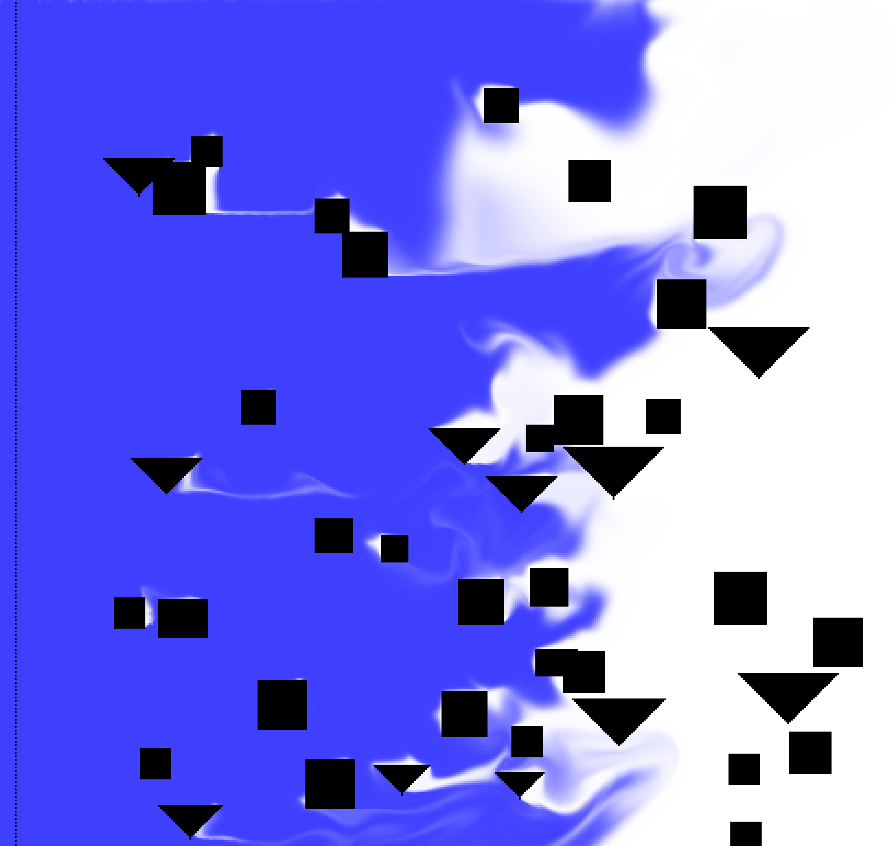

# 🌊 Fluid Simulation — TIPE

<div align="center">

**A Rust-based 2D fluid simulator for investigating airflow, cargo-ship aerodynamics and wind-assisted shipping.**


**[Overview](#-project-overview) · [Ship aerodynamics](#-from-fluid-flow-to-cargo-ship-aerodynamics) · [Numerical model](#-numerical-approach) · [Run](#-getting-started) · [Roadmap](#-roadmap)**

</div>

---

## 🖥️ Simulation gallery

<div align="center">
  
  
  <p><em>Exploring the influence of obstacles and geometry on the flow.</em></p>
  
  
  <p><em>Wake formation and vortex shedding behind obstacles.</em></p>
</div>

### Recent simulation captures

<div align="center">
  
  
  
</div>

> This is an evolving educational/research project. Images illustrate numerical experiments, not validated industrial CFD results.

---

## 📖 Project overview

This repository documents the numerical work developed for a **TIPE (Travaux d'Initiative Personnelle Encadrés)** project. What began as a general-purpose fluid simulation has developed into a framework for examining an engineering question:

> **How can the exposed geometry of a container ship be modified to reduce aerodynamic resistance, and how could wind assistance contribute to more efficient maritime transport?**

The approach is deliberately progressive: **model a flow → observe it around obstacles → calculate forces → construct ship geometries → compare configurations → work toward optimisation**.

The repository contains the Rust implementation, screenshots, presentation material and scientific bibliography.

## 🚢 From fluid flow to cargo-ship aerodynamics

### 1. Why ships?

Large cargo ships carry stacked containers, deck structures and a substantial hull above the waterline. Wind acts on these exposed surfaces, generating pressure differences and aerodynamic forces. The resulting resistance depends not only on wind speed and direction but also on **how the containers and other structures are arranged**.

This suggests two complementary research directions:

- **Reduce unwanted aerodynamic drag:** modify container stacking and add fairings to improve the airflow around exposed structures.
- **Harness the wind:** investigate wind-assisted propulsion, particularly rigid wingsails, as a future extension of the aerodynamic model.

These are related but **not identical** problems. Improving container aerodynamics reduces losses; a wingsail aims to generate a useful propulsive-force component. The current code focuses more directly on the former.

### 2. Modelling the ship in two dimensions

The `src/ship.rs` module builds a **side-profile representation of a container ship**, rather than a full three-dimensional hull. Its configurable features include:

- the main hull, bow and stern;
- bow rake, stern rake, curvature and forecastle rise;
- visible freeboard and the illustrated underwater outline;
- individual container positions and dimensions;
- aerodynamic fairings placed ahead of or behind container stacks;
- the direction of the tested airflow.

The profile includes a **static waterline**. In this ship-layout model, the region below the waterline is treated as a blocked domain; the underwater silhouette is primarily a geometric/visual representation, **not a solved hydrodynamic flow around the hull**.

### 3. Container stacking strategies

Container arrangements are described by `ContainerLayoutKind`:

| Configuration | Idea | Aerodynamic question |
| --- | --- | --- |
| **Grid** | Regular rows and columns | What happens when containers form abrupt exposed faces? |
| **Pyramid** | Stacks with a tapered arrangement | Can gradual height transitions alter the flow and drag? |
| **Staggered** | Offset container stacks | How does shifting exposed edges change the wake? |

The program can generate layouts, evaluate them over a prescribed number of simulation steps and compare their computed scores. This is an exploratory **numerical comparison**, not yet a validated claim that any particular arrangement saves a given percentage of fuel.

### 4. Aerodynamic fairings

The ship model supports fairings at the bow and stern of the cargo area. Implemented profile families include:

`Triangular` · `Rounded` · `Parabolic` · `Stepped` · `TopCover` · `Sail` · `Arc`

Fairing length, height, position and shape can be changed to investigate how the flow interacts with the first and last container stacks.

**Working hypothesis:** smoother geometric transitions may mitigate adverse pressure distributions and reduce some components of aerodynamic resistance. The simulation is intended to test that hypothesis; it should not be assumed true for every flow condition.

### 5. Measuring forces and ranking layouts

The code distinguishes labelled wall cells belonging to the **hull, containers and fairings**. Forces computed at these cells are aggregated into component-level and overall quantities.

For each tested layout the current implementation reports:

- hull-associated force;
- force for each identified container;
- total drag projected onto the selected flow direction;
- a total torque metric;
- a weighted comparison score.

The current score implemented in `src/ship.rs` is:

```text
score = W_DRAG × abs(total_drag) + W_TORQUE × total_torque
```

The torque metric is computed as the sum of absolute object torques. The weights are configurable in `src/conditions.rs`. **Lower scores are preferred by the ranking routine**, but the two terms require appropriate scaling and validation before the score can be interpreted as an engineering optimum.

```text
       Ship geometry / container layout
                      │
                      ▼
             Build 2D obstacles
                      │
                      ▼
             Simulate airflow
                      │
                      ▼
        Estimate forces on boundaries
                      │
             ┌────────┴────────┐
             ▼                 ▼
          Hull / fairings   Containers
             └────────┬────────┘
                      ▼
              Drag and torque
                      │
                      ▼
             Weighted comparison
                      │
                      ▼
             Rank candidate layouts
```

### 6. Wind profile above the surface

Wind velocity generally varies with height in the atmospheric boundary layer. The project includes configurable inflow profiles in `src/conditions.rs`:

- **Uniform** — constant incoming velocity;
- **Power law** — velocity depending on height through an adjustable exponent;
- **Logarithmic law** — a height-dependent profile with a roughness-length parameter.

The chosen reference height, exponent and roughness parameters let the project explore different assumptions about wind exposure. They are modelling inputs, not site-calibrated weather data.

### 7. Towards wingsail-assisted propulsion

A rigid wingsail can develop an aerodynamic force from the airflow around its profile. Only the component useful for moving the vessel contributes directly to propulsion; other components can create side loads and moments.

The longer-term aim is to use the simulator to study **profile geometry, apparent-wind direction and angle of attack**, then examine the trade-off between useful force, drag and torque. Realistic wingsail design and coupled vessel-performance predictions **remain future work**.

---

## 🧮 Numerical approach

The simulator uses a **two-dimensional discretised fluid domain**, with grid cells representing fluid quantities and solid boundaries.

The main code is separated into:

| Module | Role |
| --- | --- |
| `src/grid.rs` | Main fluid grid, velocity and density evolution, obstacles |
| `src/grid2.rs` | Experimental grid with Morton / Z-order indexing |
| `src/pressure_computation.rs` | Pressure-related computations |
| `src/pressure_computation2.rs` | Alternative pressure routines |
| `src/objects.rs` | Object identification, force and torque calculations |
| `src/ship.rs` | Ship profiles, container layouts, fairings and layout comparison |
| `src/water.rs` | Experimental two-fluid air/water functions |
| `src/conditions.rs` | Numerical, physical and scenario parameters |
| `src/app.rs` | Interactive rendering and controls |
| `src/visualization.rs` | Supporting / earlier visualisation code |
| `src/main.rs` | Program entry point and execution-mode selection |

### Interactive experiments

The graphical application uses **pixels/wgpu** for rendering and **egui** for its controls. Depending on the selected scenario, the interface exposes flow and geometry parameters, lets the user draw obstacles and provides drag/torque monitoring.

It also includes pause/resume, single-step execution and screenshot capture.

### Experimental air–water model

A separate module, `src/water.rs`, introduces a **VOF-inspired phase field**:

- `phase = 0`: air;
- `phase = 1`: water;
- intermediate values: a numerically diffuse interface.

Local density is interpolated between air and water; the module also contains gravity and phase-advection routines. However, **`ENABLE_WATER` is currently `false` by default**, and the configured water/air density ratio is deliberately reduced for numerical stability. It must therefore be treated as **experimental**, not as a validated wave, buoyancy or ship-hydrodynamics solver.

---

## ⚙️ Getting started

### Requirements

- Rust toolchain with Cargo (edition **2024** support);
- a desktop environment capable of opening the application's graphics window.

### Build and run

```bash
git clone https://github.com/Astraheim/Fluid-simulation-TIPE.git
cd Fluid-simulation-TIPE
cargo run --release
```

The executable is configured through constants in `src/conditions.rs`, notably:

| Setting | Purpose |
| --- | --- |
| `GRID = "1"` | Main grid / basic test path |
| `GRID = "2"` | Experimental Morton-indexed grid |
| `GRID = "3"` | Interactive application (**current default**) |
| `N`, `DT`, `VISCOSITY` | Grid size, timestep and viscosity |
| `W_DRAG`, `W_TORQUE` | Layout ranking weights |
| `WIND_PROFILE` | Inflow wind-profile model |
| `ENABLE_WATER` | Experimental two-fluid mode (**disabled by default**) |

Some scenarios and parameter combinations may still require tuning: the repository is an active research prototype, not a packaged end-user application.

---

## 🦀 Technical stack

**Rust** · **Rayon** (parallel computation) · **pixels / wgpu** (framebuffer and GPU rendering) · **egui / winit** (desktop UI) · **Plotters** and **egui_plot** (plots) · **Rand** (randomised layouts) · **minifb** (legacy/simple visualisation).

The emphasis is on a transparent numerical implementation that can be modified, measured and analysed during the TIPE.

## 📚 Research material

The `Biblio/` directory contains research material on:

- fluid simulation and numerical methods;
- **wind loads on container ships**;
- **container configurations, stacking and aerodynamic fairings**;
- **rigid wingsails and wind-assisted ship propulsion**.

The `LATEX/` directory also stores presentation material and figures associated with the development of the project.

These references provide scientific context; their conclusions must be distinguished from results actually reproduced by this solver.

---

## 🔬 Roadmap

### Implemented or available in the repository

- [x] 2D fluid grid, obstacles and flow visualisation
- [x] Interactive controls and force/torque display
- [x] Object force estimation
- [x] Ship side-profile geometry with configurable bow and stern
- [x] Container layout generation and comparison
- [x] Several bow/stern fairing profiles
- [x] Height-dependent inflow wind profiles
- [x] Weighted drag/torque ranking
- [x] Experimental Morton grid
- [x] Experimental air/water phase-field module (not enabled by default)

### Remaining research and development

- [ ] Quantify numerical convergence and stability
- [ ] Validate force estimates against reference solutions or measurements
- [ ] Document units, scaling and grid sensitivity
- [ ] Establish repeatable benchmarks for container/fairing variants
- [ ] Improve physical realism, including three-dimensional effects
- [ ] Implement and evaluate realistic rigid wingsails
- [ ] Study apparent wind and angle of attack
- [ ] Relate simulated aerodynamic changes to vessel-level performance

## ⚠️ Scope and limitations

This is a **simplified 2D numerical research tool**, not a fully validated CFD package.

Important limitations include the simplified boundary conditions and turbulence treatment, finite grid resolution, potential numerical diffusion, no complete three-dimensional representation of the ship, and no validated coupling between aerodynamic forces, hydrodynamics and fuel consumption.

**A lower simulated drag score should not be interpreted directly as a proven fuel saving.** Meaningful quantitative comparisons require convergence studies, credible reference cases and physically consistent scaling.

---

## 👤 Author

**[Astraheim](https://github.com/Astraheim)** — TIPE research project, 2026.

*Fluid mechanics · Numerical simulation · Cargo-ship aerodynamics · Container optimisation · Wind-assisted propulsion*

> **License:** No open-source license is declared in this repository. Please consult the author before reuse beyond what copyright law permits.
